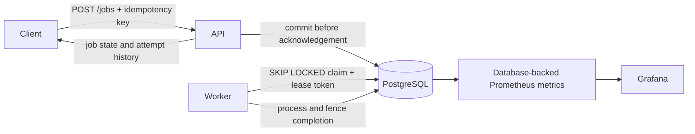

# Durable Jobs

A Go/PostgreSQL background-job service with durable submissions, concurrent
workers, bounded retries, and recovery after a worker disappears. A reliability
lab extends it with private AWS infrastructure, observability, and repeatable
failure drills.

**Stack:** Go, PostgreSQL, Python, Docker, Kubernetes, AWS EKS, Terraform,
Prometheus, and Grafana.

## How it works



- Keyed submissions return the original job on retry and reject conflicting input.
- Workers commit a claim before processing; expiring leases allow abandoned work
  to be reclaimed. Fencing tokens prevent stale workers from committing results.
- Bounded retry attempts and backoff separate temporary failures from invalid data.
- JSON logs, attempt history, queue/latency metrics, and alerts support diagnosis.
- Terraform and Kubernetes profiles cover private EKS networking, internal HTTPS
  load balancing, private DNS, workload identities, and encrypted database storage.

## Measured results

These are recorded synthetic results from a short, single-node AWS lab on
September 28–29, 2026. They are not production-capacity or availability claims.

| Experiment | Observed result | Scope |
| --- | --- | --- |
| Steady load | 600/600 jobs succeeded; 960 ms p95 enqueue-to-completion | Target 10 submissions/s for about one minute; one worker |
| Worker interrupted after claim | 33.252 s to recovery | Lease expired; the same job succeeded on its next attempt |
| PostgreSQL Pod restart | 13.446 s to recovery | Same persistent volume; not recovery after volume loss |
| Bad API rollout | Prior Pod template restored in 6.499 s | Test-driver rollback; two old API replicas remained available |

The lab used one `t3.medium` EKS node, two API replicas, one worker, and one
PostgreSQL Pod. Six failure drills covered worker interruption, database restart,
slow writes, failed rollout, invalid jobs, and retry exhaustion. A separate load
test measured normal traffic.

See the [full reliability report](docs/19-cloud-reliability.md),
[safe numerical summary](docs/evidence/aws-lab-summary.json), and
[incident reports](docs/incidents/). Private operational logs, credentials,
Terraform state, and database contents are excluded from this repository.

The temporary AWS lab was torn down. Retained artifacts can still incur small
charges; there is no claim of a zero AWS bill or an active hosted service.

## Run locally

Prerequisites: Docker Compose, Go (the toolchain is declared in `go.mod`), and Make.

```sh
cp .env.example .env
make db-up
make migrate
make run
# In another terminal:
make worker
```

The API binds to `127.0.0.1:8085`; the project database uses port `55432`.
Use the [guided tour](docs/00-guided-tour.md) for example submissions and the
[storage walkthrough](docs/02-submission-and-storage.md) for the transaction path.
`make db-stop` stops the local database while retaining its volume.

## Verify behavior

```sh
make check                # Go race tests and go vet; no database required
make integration          # Isolated test schema in the configured local database
make container-check      # Disposable database, image checks, and HTTP smoke test
make lab-tools
make demo-check           # Fresh disposable kind cluster; worker crash and recovery
```

The [release guide](docs/20-reproducible-release.md) explains the disposable demo,
its ownership checks, evidence, and cleanup. Never use a production database for
the integration target. The existing application volume is not used by the
disposable container or kind demos.

Fresh local verification on October 27, 2026 passed Go race tests and `go vet`,
90 Python platform tests, and 24 offline AWS configuration tests. Database and
Docker integration suites were not rerun locally that day because Docker was
stopped. The checked-in [CI workflow](.github/workflows/ci.yaml) also exercises
containers, mocked Terraform plans, and a disposable Kubernetes recovery demo;
consult GitHub Actions for actual hosted-run results. Cloud deployment is never
part of CI. Registry publication requires an explicit manual workflow input.

## Design and limits

- [Idempotency and concurrent submissions](docs/03-idempotency.md)
- [Worker claims, leases, retries, and crash recovery](docs/05-retries-and-recovery.md)
- [Runbook and alert responses](RUNBOOK.md)
- [AWS foundation and private networking](docs/11-aws-foundation.md)
- [Measured cloud reliability](docs/19-cloud-reliability.md)

Persisted job results are fenced, but external side effects are not guaranteed
to execute exactly once. One database Pod and one worker node do not establish
high availability. The application has no public authentication/UI, arbitrary
script uploads, or production uptime commitment. The local reviewed-script
sandbox is not a hostile multi-tenant execution service.

This is an AI-assisted personal project; tests and measured experiments establish
system behavior, not independent authorship of every implementation detail.
Account-specific cloud guards in the public source use a fixed example account
instead of the original lab account. A new AWS lab requires explicit per-lab
configuration and separate deployment approval; publishing this repository does
not start cloud resources.
