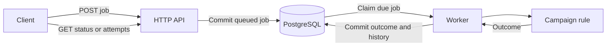

# Start here: follow one campaign through Durable Jobs

This is a background-processing service, not the job-search automation folder.
Its purpose is to transform synthetic campaign records reliably even when HTTP
requests are repeated, workers compete or a worker crashes. The taxonomy and
records are invented; no employer data is used.

## 1. Understand the business rule first

Open [campaign/migrate.go](../internal/campaign/migrate.go), function `Migrate`.
Input:

```json
{"campaign_id":"campaign_42","category":"Pets","created_at":"08/31/2026"}
```

Output:

```json
{"campaign_id":"campaign_42","category_id":"animals","created_date":"2026-08-31","schema_version":1}
```

The category switch maps `Pets` to `animals`. Date parsing accepts the exact
legacy format or ISO date and rejects nonexistent dates. The function does not
know about HTTP, SQL or workers. This separation is the concrete domain-design
choice: the business rule is independently testable, not a framework feature.

Prediction: change the date to `02/29/2026`. It must fail, since 2026 has no
February 29. Retrying the same input cannot repair it.

## 2. Submit work without running it in the HTTP request

Open [httpapi/handler.go](../internal/httpapi/handler.go), `POST /jobs`, then
[database/jobs.go](../internal/database/jobs.go), `Create`.

```json
{
  "type": "migrate_campaign",
  "payload": {
    "campaign_id": "campaign_42",
    "category": "Pets",
    "created_at": "08/31/2026"
  }
}
```

The handler checks the request envelope. `Create` inserts the job in PostgreSQL
and commits before the handler returns `202 Accepted`. The job starts `queued`,
with zero attempts. Acceptance is not proof of processing success.



The worker is a separate process polling PostgreSQL, not an HTTP callback. The
API can restart without losing committed jobs. No worker means no processing.

## 3. Repeat the request safely

For the same logical submission, use the same `Idempotency-Key`, for example
`tour-campaign-42`, and the same input.

- Same key and equivalent JSON input: returns the same job ID/current state.
- Same key with changed input: returns `409 Conflict`.
- No key: each request creates a new job.

In `Create`, find `ON CONFLICT (idempotency_key) DO NOTHING`. PostgreSQL enforces
the uniqueness even when two API instances submit simultaneously. A separate
SELECT retrieves the committed competing row and compares its input. This is
not a process-local map that disappears on restart.

## 4. Give one worker temporary ownership

Open [worker/worker.go](../internal/worker/worker.go), `RunOnce`, followed by
[database/execution.go](../internal/database/execution.go), `Claim`.

Each iteration recovers a small batch of expired claims, then claims one due
job. Claiming commits all of the following before execution:

- Job changes `queued`/`retry_waiting` to `running`.
- Attempt count increases and a running history row is inserted.
- A new claim token and lease expiry are stored.

`FOR UPDATE SKIP LOCKED` means another worker skips a job row already locked
by a competing claim transaction. It can look for other work instead. The
transaction is short: the actual campaign transform runs after commit.

`worker/campaign.go` is the adapter connecting the generic worker to `Migrate`.
Then `Finish` commits either the result or a safe failure code with the attempt
outcome. `GET /jobs/{id}` reads that stored state.

## 5. Follow a crash, not just the happy path

Imagine job J has these events (times and tokens are illustrative):

| Time | Event | Job state | Attempt count |
| --- | --- | --- | --- |
| 12:00:00 | Worker A claims with token A and a 30-second lease | running | 1 |
| 12:00:05 | Worker A crashes | running | 1 |
| 12:00:31 | Another worker polls and recovers the expired claim | retry_waiting | 1 |
| 12:00:32 | Worker B claims with a new token B | running | 2 |
| Shortly after | Worker B finishes and commits the result | succeeded | 2 |

Time passing alone does not change the row: a worker's recovery poll does.
History records attempt one as `lease_expired` and attempt two as `succeeded`.
No new logical job or submission key is needed.

What if A was paused rather than dead and returns late? `Finish` locks the row
and checks this condition before accepting any output:

```sql
WHERE id = $1 AND status = 'running' AND lease_token::text = $2
    AND lease_expires_at > clock_timestamp()
```

A's old token cannot complete B's attempt. This protects database results, not
external actions such as already-sent emails. The current processor performs no
external side effects; this is not an exactly-once execution claim.

## 6. Decide whether another attempt is useful

Open [jobs/retry.go](../internal/jobs/retry.go), `AfterFailure`.

```go
next, delay := jobs.AfterFailure(jobs.TransientFailure, 1, 3)
// next == jobs.RetryWaiting; delay == time.Second
```

The same call with `jobs.InvalidCampaign` returns `jobs.Failed` and zero delay.
A default job allows three committed claims total, not three retries after the
first attempt. Retry delays are one second and then two seconds. Attempt three
is the final chance. Crashed claims also consume that budget.

## What is built, and what comes next?

Built before this tour: persistent submission, idempotency, the pure campaign
rule, concurrent worker claims, leases, fenced completion, bounded retries,
expired-claim recovery, attempt history and regression/integration tests.

Added after this walkthrough: a repeatable failure-testing harness with ten
named scenarios, six JSON fixtures, expected versus observed results and a
readable/machine-readable report. Run `make harness` from this folder with
PostgreSQL running. It uses isolated schemas, not the application queue.
Read [the harness walkthrough](06-failure-harness.md) for the command and report.
A [separate constrained Python CLI](07-script-runner.md) was added September 16.
The queue journey above still runs the built-in Go processor, not uploaded scripts.
The [next milestone](08-versioned-script-jobs.md) connects a reviewed, pinned
Python catalog version to that same queue. Run `make script-queue-check` for the
isolated end-to-end check; no application jobs are processed by that command.

Suggested reading order: campaign rule → HTTP submission → SQL Create → worker
RunOnce → SQL Claim/Finish → retry policy → recovery. You do not need to read
every test or migration before understanding this one journey.

Two small understanding checks:

1. Why should an invalid calendar date fail immediately rather than retry?
2. Why is the job ID alone insufficient to authorize a worker's completion?

Detailed follow-ups: [submission](02-submission-and-storage.md),
[idempotency](03-idempotency.md), [domain/worker](04-worker-and-domain.md) and
[retries/recovery](05-retries-and-recovery.md).
